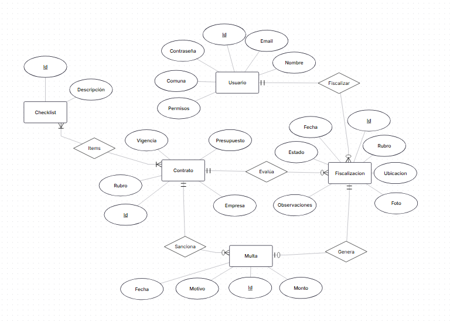

# SIFCOM — Backend API REST y Modelo de Base de Datos Relacional

## Presentado por
- Nicolás Alejandro Leiva Aguilar
- Ricardo Andrés Pastén Oblitas

### Distribución de responsabilidades

| Integrante | Rol en el equipo | Responsabilidades principales |
|---|---|---|
| **Nicolás Alejandro Leiva Aguilar** | Arquitectura Backend, Modelo de Datos y Seguridad | Diseño del modelo relacional y script `schema.sql`, construcción del servidor en Node.js + Express, autenticación con `bcrypt` y `JWT`, controles de seguridad OWASP API 2023 y pruebas de endpoints. |
| **Ricardo Andrés Pastén Oblitas** | Diseño del MER, Integración REST y Validaciones | Modelado Entidad-Relación (MER), definición de contratos JSON entre frontend y backend, integración de servicios CRUD (`contratos`, `fiscalizaciones`, `multas`, `perfil`) y pruebas funcionales. |

---

## Índice
1. [Descripción general del Backend](#descripción-general-del-backend)
2. [Modelo Entidad-Relación (MER)](#modelo-entidad-relación-mer)
3. [Diseño de Base de Datos Relacional y Claves (`schema.sql`)](#diseño-de-base-de-datos-relacional-y-claves-schemasql)
4. [Seguridad Aplicada y Mitigación OWASP API Security 2023](#seguridad-aplicada-y-mitigación-owasp-api-security-2023)
5. [Catálogo y Contrato de Endpoints API REST](#catálogo-y-contrato-de-endpoints-api-rest)
6. [Estructura modular del servidor](#estructura-modular-del-servidor)
7. [Instrucciones de instalación, configuración y ejecución](#instrucciones-de-instalación-configuración-y-ejecución)
8. [Pruebas funcionales en Postman / Insomnia](#pruebas-funcionales-en-postman--insomnia)

---

## Descripción general del Backend

Esta rama (`backend`) contiene el servidor **API RESTful** de **SIFCOM** (Sistema de Fiscalización en Terreno de Contratos Municipales), desarrollado con **Node.js**, **Express** y **PostgreSQL**.

El servidor gestiona la persistencia relacional de usuarios, contratos municipales, listas de verificación (*checklists*), fiscalizaciones en terreno y multas asociadas, proveyendo autenticación mediante **JSON Web Tokens (JWT)**, cifrado de contraseñas con **bcrypt**, autorización diferenciada por roles (`INSPECTOR` y `ADMIN`) y controles activos frente a las vulnerabilidades **OWASP API Security Top 10 (2023): API1, API2, API4, API8 y API9**.

---

## Modelo Entidad-Relación (MER)

El modelo conceptual del dominio se compone de **5 entidades principales** (`Usuario`, `Contrato`, `Checklist`, `Fiscalizacion` y `Multa`) y sus relaciones con cardinalidades explícitas:



### Relaciones y cardinalidades del MER
1. **`Usuario` `(1,1)` — *Fiscalizar* — `(0,N)` `Fiscalizacion`:** Un usuario autenticado puede registrar cero o muchas fiscalizaciones; cada fiscalización pertenece a un único autor responsable.
2. **`Contrato` `(1,1)` — *Evalúa* — `(0,N)` `Fiscalizacion`:** Un contrato municipal puede ser evaluado en cero o muchas fiscalizaciones; cada fiscalización evalúa un único contrato.
3. **`Checklist` `(1,N)` — *Items* — `(1,N)` `Contrato`:** Relación muchos a muchos (`N:M`) entre los ítems de verificación y los contratos municipales, resuelta en el modelo físico mediante la tabla intermedia `itemschecklist`.
4. **`Fiscalizacion` `(1,1)` — *Genera* — `(0,1)` `Multa`:** Una fiscalización con incumplimiento grave puede generar hasta una multa asociada.
5. **`Contrato` `(1,1)` — *Sanciona* — `(0,N)` `Multa`:** Un contrato municipal puede acumular cero o muchas multas a lo largo de su vigencia; toda multa sanciona obligatoriamente a un contrato.

---

## Diseño de Base de Datos Relacional y Claves (`schema.sql`)

El archivo reproducible **`schema.sql`** ubicado en la raíz de esta rama crea las tablas en **PostgreSQL**, declara todas las **Claves Primarias (`PRIMARY KEY`)**, **Claves Foráneas (`FOREIGN KEY`)**, restricciones de unicidad (`UNIQUE`) y dominio (`CHECK`), e inserta los datos iniciales de prueba (*seed*).

### Diccionario de Tablas y Keys

| Tabla SQL | Entidad / Relación MER | Clave Primaria (PK) | Claves Foráneas (FK) | Restricciones (`UNIQUE` / `CHECK`) |
|---|---|---|---|---|
| **`usuario`** | Entidad `Usuario` | `iduser` (`SERIAL PK`) | — | `email UNIQUE NOT NULL`<br>`CHECK (permisosuser IN ('ADMIN', 'INSPECTOR'))` |
| **`contrato`** | Entidad `Contrato` | `idcontrato` (`SERIAL PK`) | — | `CHECK (presupuesto >= 0)` |
| **`checklist`** | Entidad `Checklist` | `idchecklist` (`SERIAL PK`) | — | `descripcion UNIQUE NOT NULL` |
| **`itemschecklist`** | Relación `Items` (`N:M`) | `(idchecklist, idcontrato)` (`PK Compuesta`) | `idchecklist` → `checklist(idchecklist)`<br>`idcontrato` → `contrato(idcontrato)` | `ON DELETE CASCADE` |
| **`fiscalizacion`** | Entidad `Fiscalizacion` | `idfiscalizacion` (`SERIAL PK`) | `iduser` → `usuario(iduser)`<br>`idcontrato` → `contrato(idcontrato)` | `CHECK (estado IN ('CUMPLE', 'ALERTA', 'MULTA', 'PENDIENTE'))` |
| **`fiscalizacion_checklist`** | Respuestas de ítems en `Fiscalizacion` | `(idfiscalizacion, idchecklist)` (`PK Compuesta`) | `idfiscalizacion` → `fiscalizacion(idfiscalizacion)`<br>`idchecklist` → `checklist(idchecklist)` | `cumple BOOLEAN NOT NULL` |
| **`multa`** | Entidad `Multa` + Relaciones `Sanciona` y `Genera` | `idmulta` (`SERIAL PK`) | `idcontrato` → `contrato(idcontrato)` (`NOT NULL`)<br>`idfiscalizacion` → `fiscalizacion(idfiscalizacion)` (`NOT NULL`) | `idfiscalizacion UNIQUE`<br>`CHECK (monto > 0)` |

---

## Seguridad Aplicada y Mitigación OWASP API Security 2023

El backend fue diseñado aplicando defensas específicas contra **Inyección SQL** y las vulnerabilidades **OWASP API Security Top 10 (2023)** solicitadas:

| Categoría OWASP 2023 | Riesgo que previene | Implementación técnica en `sifcom-backend` |
|---|---|---|
| **API1:2023 — Broken Object Level Authorization (BOLA)** | Que un inspector acceda o modifique reportes o perfiles de otros usuarios manipulando IDs en la ruta o en el cuerpo JSON. | - El identificador del usuario autenticado se obtiene exclusivamente del token verificado (`req.user.IdUser`), ignorando cualquier `IdUser` enviado en `req.body`.<br>- En `GET /api/fiscalizaciones` y `GET /api/fiscalizaciones/:id`, si el rol es `INSPECTOR`, la consulta SQL filtra por `WHERE f.iduser = $1` y rechaza con `403 Forbidden` el acceso a reportes ajenos.<br>- En `GET/PUT /api/usuarios/perfil`, solo se consulta y actualiza la fila de `req.user.IdUser`. |
| **API2:2023 — Broken Authentication** | Almacenamiento inseguro de contraseñas, tokens sin expiración, ataques de fuerza bruta o auto-asignación de rol `ADMIN` al registrarse. | - Contraseñas cifradas con **`bcryptjs` (`cost = 10`)** y política mínima de **8 caracteres + 1 número**.<br>- En `POST /api/auth/register` el servidor asigna de forma fija `permisosuser = 'INSPECTOR'`, impidiendo escalación de privilegios.<br>- Tokens JWT firmados con algoritmo explícito **`HS256`** y expiración de **`2 horas` (`expiresIn: '2h'`)**.<br>- Limitador de intentos (`authLimiter`: máx. 15 peticiones / 15 min por IP) y mensaje uniforme `"Credenciales inválidas"` (`401`). |
| **API4:2023 — Unrestricted Resource Consumption** | Denegación de servicio por cuerpos JSON excesivamente grandes, ráfagas masivas de peticiones o consultas sin cota de filas. | - Límite estricto en el parser JSON: `express.json({ limit: '100kb' })` (devuelve `413 Payload Too Large` si se excede).<br>- Middleware `createRateLimiter` global en `/api` (`120 req/min` por IP, respondiendo `429 Too Many Requests` con cabecera `Retry-After`).<br>- Cláusula `LIMIT` acotada (`máx. 200` registros) en listados de fiscalizaciones y multas. |
| **API8:2023 — Security Misconfiguration** | Exposición de cabeceras del servidor, CORS permisivo o filtración de errores internos de PostgreSQL/stacktraces al cliente. | - Desactivación de firma del servidor con `app.disable('x-powered-by')` y aplicación de cabeceras seguras (`X-Content-Type-Options: nosniff`, `X-Frame-Options: DENY`, `Referrer-Policy`).<br>- Configuración de `cors()` restringida a la lista blanca `ALLOWED_ORIGINS`.<br>- Middleware `errorHandler` que registra el error en consola del servidor pero devuelve al cliente un mensaje genérico seguro en estado `500`. |
| **API9:2023 — Improper Inventory Management** | Rutas de depuración expuestas con datos sensibles o respuestas HTML no controladas en rutas inexistentes. | - Montaje ordenado de recursos bajo `/api` y `/api/v1`.<br>- El endpoint `/api/health` verifica conectividad sin exponer nombres internos de base de datos ni variables de entorno.<br>- Middleware `notFoundHandler` que responde en JSON estándar `404` ante cualquier ruta o verbo no registrado. |
| **Prevención de SQL Injection** | Inyección de comandos SQL a través de `req.body`, `req.params` o `req.query`. | - Uso exclusivo de consultas parametrizadas (`$1, $2, ...`) con el driver `pg` (`Pool`) y validación previa de enteros positivos en `req.params.id` (`parsePositiveIntParam` → `400 Bad Request`). |

---

## Catálogo y Contrato de Endpoints API REST

Todas las rutas están disponibles bajo `/api` (y versionadas en `/api/v1`):

| Método | Endpoint | Autenticación / Rol | Entrada (`params` / `body`) | Respuestas HTTP |
|---|---|---|---|---|
| `GET` | `/api/health` | Pública | — | `200 OK` `{ ok: true, status: "healthy" }` |
| `POST` | `/api/auth/register` | Pública (con Rate Limit) | **Body:** `{ Nombre, Comuna, Email, Contrasena }` | `201 Created` · `400 Bad Request` · `409 Conflict` · `429 Too Many Requests` |
| `POST` | `/api/auth/login` | Pública (con Rate Limit) | **Body:** `{ Email, Contrasena }` | `200 OK` `{ ok: true, token, user }` · `400` · `401 Unauthorized` |
| `GET` | `/api/usuarios/perfil` | JWT (`INSPECTOR` / `ADMIN`) | **Header:** `Authorization: Bearer <token>` | `200 OK` · `401 Unauthorized` |
| `PUT` | `/api/usuarios/perfil` | JWT (`INSPECTOR` / `ADMIN`) | **Body:** `{ Nombre, Email, Comuna, Contrasena? }` | `200 OK` · `400` · `401` · `409 Conflict` |
| `GET` | `/api/contratos` | JWT (`INSPECTOR` / `ADMIN`) | — | `200 OK` (Lista de contratos) · `401` |
| `GET` | `/api/contratos/:id` | JWT (`INSPECTOR` / `ADMIN`) | **Param:** `:id` (entero positivo) | `200 OK` · `400 Bad Request` · `404 Not Found` |
| `GET` | `/api/contratos/:id/checklists` | JWT (`INSPECTOR` / `ADMIN`) | **Param:** `:id` (entero positivo) | `200 OK` (Ítems de checklist asociados al contrato) |
| `POST` | `/api/contratos` | JWT (`ADMIN`) | **Body:** `{ Empresa, Giro, Presupuesto, Vigencia }` | `201 Created` · `400` · `401` · `403 Forbidden` |
| `PUT` | `/api/contratos/:id` | JWT (`ADMIN`) | **Param:** `:id` · **Body:** `{ Empresa, Giro, Presupuesto, Vigencia }` | `200 OK` · `400` · `403` · `404 Not Found` |
| `DELETE` | `/api/contratos/:id` | JWT (`ADMIN`) | **Param:** `:id` (entero positivo) | `204 No Content` · `400` · `403` · `404 Not Found` |
| `GET` | `/api/checklists` | JWT (`INSPECTOR` / `ADMIN`) | — | `200 OK` (Catálogo de ítems de verificación) |
| `GET` | `/api/fiscalizaciones` | JWT (`INSPECTOR` propias / `ADMIN` todas) | **Query opcional:** `?limit=100` | `200 OK` · `401 Unauthorized` |
| `GET` | `/api/fiscalizaciones/:id` | JWT (Propiedad BOLA o `ADMIN`) | **Param:** `:id` (entero positivo) | `200 OK` · `400` · `403 Forbidden` · `404 Not Found` |
| `POST` | `/api/fiscalizaciones` | JWT (`INSPECTOR` / `ADMIN`) | **Body:** `{ IdContrato, Obra, Ubicacion?, Foto?, Observaciones?, Estado?, Respuestas? }` | `201 Created` · `400` · `401` · `404` |
| `PUT` | `/api/fiscalizaciones/:id` | JWT (`ADMIN`) | **Param:** `:id` · **Body:** `{ IdContrato, Obra, Ubicacion?, Foto?, Observaciones?, Estado? }` | `200 OK` · `400` · `403` · `404` |
| `DELETE` | `/api/fiscalizaciones/:id` | JWT (`ADMIN`) | **Param:** `:id` (entero positivo) | `204 No Content` · `400` · `403` · `404` |
| `GET` | `/api/multas` | JWT (`INSPECTOR` / `ADMIN`) | — | `200 OK` |
| `POST` | `/api/multas` | JWT (`ADMIN`) | **Body:** `{ Monto, Motivo, IdContrato, IdFiscalizacion, FechaMulta? }` | `201 Created` · `400` · `403` |
| `PUT` | `/api/multas/:id` | JWT (`ADMIN`) | **Param:** `:id` · **Body:** `{ Monto, Motivo, IdContrato, IdFiscalizacion }` | `200 OK` · `400` · `403` · `404` |
| `DELETE` | `/api/multas/:id` | JWT (`ADMIN`) | **Param:** `:id` (entero positivo) | `204 No Content` · `400` · `403` · `404` |

---

## Estructura modular del servidor

```text
sifcom/ (rama backend)
├── docs/
│   ├── mer-sifcom.png                 # Diagrama Entidad-Relación (MER)
│   └── SIFCOM.postman_collection.json # Colección Postman / Insomnia con 10 pruebas funcionales
├── src/
│   ├── config/
│   │   └── db.js                      # Pool de conexión PostgreSQL e inicialización automática
│   ├── middlewares/
│   │   └── security.js                # JWT, roles, rate-limiter, cabeceras, validador de IDs y errores
│   └── routes/
│       ├── auth.routes.js             # Registro, login con bcrypt y actualización de perfil
│       ├── contratos.routes.js        # CRUD de contratos y consulta de checklists
│       └── fiscalizaciones.routes.js  # CRUD de fiscalizaciones y multas con protección BOLA
├── .env.example                       # Plantilla de variables de entorno
├── index.js                           # Punto de entrada de la aplicación Express
├── package.json                       # Dependencias y scripts de ejecución
├── README.md                          # Documentación técnica del backend
└── schema.sql                         # Script SQL reproducible (DDL + PK/FK + datos iniciales)
```

---

## Instrucciones de instalación, configuración y ejecución

### 1. Requisitos previos
- **Node.js:** v20.x o superior.
- **PostgreSQL:** v14 o superior en ejecución local (`localhost:5432`).

### 2. Clonar el repositorio y cambiar a la rama `backend`

```bash
git clone https://github.com/nico0417/sifcom.git
cd sifcom
git checkout backend
```

### 3. Crear la base de datos y ejecutar `schema.sql`

Puedes cargar manualmente el archivo `schema.sql` en PostgreSQL (además, el servidor verifica e inicializa el esquema y los datos semilla automáticamente al iniciar):

```bash
psql -U postgres -c "CREATE DATABASE sifcom;"
psql -U postgres -d sifcom -f schema.sql
```

### 4. Configurar las variables de entorno (`.env`)

```bash
cp .env.example .env
```

Edita `.env` con las credenciales de tu instancia local de PostgreSQL:

```env
PORT=4000
DB_HOST=localhost
DB_PORT=5432
DB_NAME=sifcom
DB_USER=postgres
DB_PASSWORD=tu_password_postgres
JWT_SECRET=secreto_jwt_seguro_sifcom_2026
ALLOWED_ORIGINS=http://localhost:5173,http://127.0.0.1:5173
```

### 5. Instalar dependencias e iniciar el servidor

```bash
npm install
npm run dev
```

El servidor quedará escuchando en `http://localhost:4000`.

---

## Pruebas funcionales en Postman / Insomnia

En la carpeta `docs/SIFCOM.postman_collection.json` se incluye la colección exportada lista para importar en **Postman** o **Insomnia**.

### Casos de prueba incluidos y verificables:
1. **Healthcheck (`GET /api/health`):** Verifica respuesta `200 OK` y conexión con PostgreSQL sin exponer datos sensibles.
2. **Registro de usuario (`POST /api/auth/register`):** Valida creación de cuenta con hash `bcrypt` (`201 Created`) y rechazo `409 Conflict` si el correo se repite.
3. **Inicio de sesión Admin e Inspector (`POST /api/auth/login`):** Devuelve `200 OK` con token JWT firmado y rol correspondiente (`ADMIN` o `INSPECTOR`).
4. **Control de acceso por rol (`POST /api/contratos`):** Con `tokenAdmin` responde `201 Created`; con `tokenInspector` responde `403 Forbidden`.
5. **Validación de parámetros de ruta (`GET /api/contratos/abc`):** Responde `400 Bad Request` indicando que el parámetro `id` debe ser un entero positivo.
6. **Control BOLA en Fiscalizaciones (`GET /api/fiscalizaciones`):** Un `INSPECTOR` visualiza únicamente sus reportes registrados, mientras que un `ADMIN` audita la totalidad de los reportes y multas.
